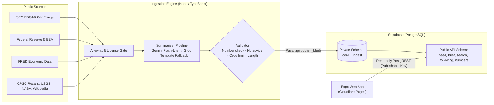

# Element

**The news that touches your life, in plain words.** Element turns public records—company filings, Federal Reserve decisions, government economic releases, product recalls, earthquakes, space news, and major world events—into short, verifiable cards in a swipe feed. Every card links to its primary source, and every number on it is verified against that source text in code before publishing.

> Informational only · Not investment advice

- **Live site:** https://element-news.pages.dev
- **Code:** https://github.com/AndrewPatton27/element
- **Video:** VIDEO_URL <!-- [CHECK: Replace VIDEO_URL with the final Devpost/YouTube submission demo link] -->
- Built for the **Lehigh Valley Hackathon (Fall 2026)**, *Open Reimagination* track.

---

## What It Is

Market and public news is dense, scattered, and often wrapped in hype, speculation, or paywalls. Primary documents (SEC filings, Federal Reserve releases, agency data) are public and reliable, but written for specialists.

Element reimagines public record ingestion into an honest, fast mobile/web feed:
- **Concise:** A headline of ~60 characters and 2–3 plain-language sentences written at an accessible reading level.
- **Deep when needed:** Tap any card to open a "More detail" sheet with key bullet points, short background paragraphs, and direct links to the raw public record.
- **Auditable & Honest:** Summaries are verified by code against the source text, strictly labeled, and banned from giving financial advice.

---

## Key Features

- **Swipe Feed with 3-Mode Ranking & For-You Personalization:**
  - **Trending:** Orders stories by objective importance (event weight × source authority) with an 8-hour half-life decay, cold-start spread, and distinct-reader engagement boosts.
  - **Latest:** Real-time chronological ordering.
  - **For You:** Dynamic personalization factoring in reader dwell time, explicit likes/dislikes, followed topics, skip penalty signals, and a shared-taste ranking helper.
- **Daily & Weekly Brief:**
  - Executive briefings breaking down the day or week into structured sections, top story rows, macroeconomic indicators, and market movers—each item complete with source links and required labels.
- **Debounced Search & Topic Discovery:**
  - Real-time search across filings, releases, and categories with debounced input, saved recent searches, and browseable topic categories.
- **Following Hub:**
  - Follow specific topics, companies, and government sources into a dedicated feed with clear explanations of why each story was delivered.
- **Macro Numbers to Know & Data Cards:**
  - Daily, weekly, monthly, and quarterly economic numbers (Treasury yields, fed funds rate, CPI, unemployment rate, WTI oil, retail sales, GDP growth) with agency attribution, FRED notices, trend direction, and automated data cards for significant indicator moves.

---

## How It Stays Trustworthy

Trust in Element is enforced by code, automated tests, and database constraints, not promises:

1. **Strict Source Gate & Allowlist:** Full web pages may only be fetched from approved government hosts (`www.sec.gov`, `www.federalreserve.gov`, `www.bls.gov`). All other data comes strictly from authorized public APIs. Unlicensed or paywalled web sources are refused in code.
2. **Every Number is Checked:** The validator rejects any generated blurb containing numbers, statistics, percentages, or ticker symbols that do not appear verbatim in the source document.
3. **No Financial Advice:** Words like "buy", "sell", "should", "target price", "outperform", and similar advice terminology cause an immediate rejection.
4. **Short Quote Limits:** Code limits consecutive copied words to 10 from filings/Wikipedia and 25 from public-domain government releases to guarantee genuine synthesis.
5. **Clear Disclaimers & Provenance:**
   - Every card states: `"Informational only · Not investment advice"`.
   - AI-generated summaries explicitly state: `"AI-generated summary · may contain errors"`.
   - Programmatic template cards and data cards omit the AI label because no LLM touched them.
6. **No Secrets in the Client:** The client bundle only holds the public Supabase URL and publishable key. All AI, database write, and ingestion credentials remain in git-ignored server environments.
7. **Sample Data Transparency:** When running offline without credentials, all mock headlines are prefixed with `[SAMPLE]` and an omnipresent banner warns the reader.

---

## Architecture & Tech Stack



- **Frontend & App:** Expo SDK 58 (React Native Web, React 19, TypeScript) with Expo Router. Responsive design for mobile swipe cards and desktop wide-screen views with navigation rails and keyboard navigation (`j`/`k`, arrows).
- **Backend & Database:** Supabase (PostgreSQL) with Row-Level Security (RLS) separating private ingestion tables (`core`, `ingest`) from the exposed read-only PostgREST interface (`api`).
- **AI Pipeline:** Google Gemini Flash-Lite (free tier) with Groq (`gpt-oss-120b`) fallback. If both are unreachable, deterministic template cards are assembled directly from the record fields.
- **Hosting:** Cloudflare Pages static export deployed via Wrangler.

---

## Data Sources and Licenses

| Source | Data Used | Terms / License |
|---|---|---|
| [SEC EDGAR](https://www.sec.gov/) | 8-K filings (earnings, leadership changes, deals, material events) | U.S. public records; compliant with [SEC access rules](https://www.sec.gov/search-filings/edgar-search-assistance/accessing-edgar-data) (declared User-Agent, rate limit) |
| [Federal Reserve](https://www.federalreserve.gov/) | Press releases and policy rate decisions | U.S. government publication; [disclaimer](https://www.federalreserve.gov/disclaimer.htm) |
| [BEA](https://www.bea.gov/) | GDP, personal income, and national account releases | U.S. government; [reuse terms](https://www.bea.gov/help/faq/147) |
| [Federal Register](https://www.federalregister.gov/) | Final agency consumer/economic rules | U.S. government; [API and reuse](https://www.federalregister.gov/reader-aids/developer-resources/rest-api) |
| [FRED](https://fred.stlouisfed.org/) | 12 economic series (Yields, Fed Funds, CPI, Oil, Gas, Unemployment, Claims) | [FRED terms of use](https://fred.stlouisfed.org/docs/api/terms_of_use.html); original reporting agencies credited |
| [Wikipedia "In the news"](https://en.wikipedia.org/wiki/Wikipedia:Reusing_Wikipedia_content) | Major global news events | [CC BY-SA 4.0](https://creativecommons.org/licenses/by-sa/4.0/); adapted with full attribution |
| [CPSC](https://www.cpsc.gov/Recalls) | Consumer product safety recalls | U.S. government public domain |
| [USGS](https://earthquake.usgs.gov/earthquakes/feed/) | Significant earthquake event reports (template cards) | U.S. government public domain |
| [NASA](https://www.nasa.gov/news-release/) | Space exploration and science releases | [NASA media guidelines](https://www.nasa.gov/nasa-brand-center/images-and-media/) |

*This product uses the FRED® API but is not endorsed or certified by the Federal Reserve Bank of St. Louis.*

---

## Running Locally

### Prerequisites
- Node.js 22.18 or newer (`node -v`)
- npm

### 1. App on Sample Data (No Keys Required)
Clone the repository and launch the web development server:
```bash
git clone https://github.com/AndrewPatton27/element.git
cd element
npm install
npx expo start --web
```
The app loads in mock mode using fixtures from `contract/fixtures/` and displays the `[SAMPLE]` banner.

### 2. App Connected to Supabase
1. Copy the example environment file:
   ```bash
   cp .env.example .env
   ```
2. Configure your client variables:
   ```env
   EXPO_PUBLIC_API_MODE=supabase
   EXPO_PUBLIC_SUPABASE_URL=https://your-project.supabase.co
   EXPO_PUBLIC_SUPABASE_PUBLISHABLE_KEY=your-anon-publishable-key
   ```
3. Run `npx expo start --web`.

### 3. Ingestion Pipeline
The ingestion scripts run independently with zero external dependencies:
```bash
cd ingest
npm test           # Run offline ingestion unit tests
npm run dry-run    # Process test fixtures through summarize & validate without publishing
```

---

## Automated Tests

Element includes end-to-end unit, contract, and parsing test suites across the entire stack:

```bash
# Run app logic, contract, and formatting tests (168 tests pass)
npm run test:app

# Run ingestion pipeline, validator, and allowlist tests
npm run test:ingest

# Run TypeScript typecheck across all files
npx tsc --noEmit
```

---

## Project Structure

```
├── app/          # Expo Router screens (Feed, Brief, Search, Following, Account, About)
├── components/   # Pager, Cards, DetailSheet, NumbersPanel, Shell, Chips
├── contract/     # API contracts, data types, and static mock fixtures
├── ingest/       # Standalone Node/TS ingestion, validation, and AI pipeline
├── lib/          # State hooks, ranking logic, search/following handlers, API client
├── supabase/     # PostgreSQL migrations (schemas, RLS, functions, and ranking)
└── assets/       # Icons and application graphics
```

---

## License

The code is released under the [MIT License](LICENSE). News content keeps its own terms: see the data sources and credits above.
