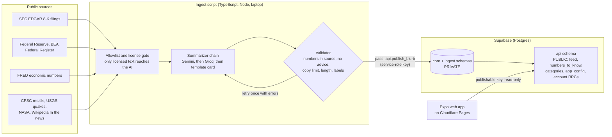

# Element

**The news that touches your life, in plain words.** Element turns public records (company filings, Federal Reserve and government releases, economic numbers, product recalls, earthquakes, space news, major world events) into short cards in a swipe feed. Every card links to its source, and every number on it has been checked against that source.

> Informational only · Not investment advice

- **Live site:** https://element-news.pages.dev
- **Code:** https://github.com/AndrewPatton27/element
- **3-minute video:** VIDEO_URL <!-- PLACEHOLDER: replace VIDEO_URL with the Devpost/YouTube link before submitting -->
- Built for the Lehigh Valley Hackathon (Fall 2026), Open Reimagination track.

<!-- Screenshots to add: feed card (phone width), "More detail" sheet, Numbers page, About page -->

## What it is

Element is a web app (Expo / React Native, with iOS and Android support in the same codebase) that shows one short card at a time. A card is a headline of about 60 characters and 2 to 3 sentences of plain language, written for busy people and college students at about an 8th-grade reading level. Tap a card for a longer "More detail" view with key points, or tap its source chip to open the original document.

## Why

News is long, scattered and often mixed with opinion, hype and "buy now" tips. The most reliable material, such as SEC filings, Federal Reserve releases and agency data, is public but written for experts. Element reimagines it as a quick, honest feed:

- **Short.** A headline and a few sentences. Precise details (exact times, model numbers, coordinates) live only in the "More detail" view.
- **Sourced.** Every card links to the original record.
- **Checked.** AI summaries are labelled, validated by code against the source text, and never give advice.
- **Open about itself.** An About page lists every source, its license, and exactly how cards are collected, filtered, written and ordered.

## Features

- **Swipe feed** with one card per screen. On desktop: a centered column, a looping "Numbers to know" ticker across the top, and keyboard keys (arrows, PageUp/PageDown, j/k) to move between cards.
- **Three feeds:** **Trending** (most important and fresh, nudged by what readers engage with), **Latest** (newest first) and **For you** (signed-in readers only).
- **Categories:** World, Government, Economy, Money, Business, Tech, Science & Space, Recalls & Safety, Earnings, Deals, Energy, Insider trades. Filter with the category chips. The live app lists only categories that currently have cards.
- **In-depth detail.** Tapping a card opens a sheet with key points and a few short paragraphs, the sources, and the labels.
- **Numbers to know.** Daily, weekly, monthly and quarterly economic numbers (Treasury yields, the fed funds rate, inflation, unemployment, oil and gas prices, jobless claims, retail sales, housing starts, payrolls, GDP growth), each naming the agency that produced it and linking to the original series. Big moves also become data cards in the feed.
- **Accounts (optional).** Email and password through Supabase Auth. Signed-in readers can mark topics as favorite or hidden, switch off individual sources, tap More / Less on cards, change their email or password, reset a forgotten password, delete their data, or delete the account. Reading never needs an account.
- **Transparency About page.** Every source with its website and terms link, how cards are collected, filtered and written, how each feed is ordered, and what an account stores.
- **Sample mode.** With no keys the app runs on fictional sample cards (every headline starts with `[SAMPLE]`) and shows a "SAMPLE DATA" banner.

## How it works



1. **Collect.** The ingest script fetches official feeds and data services. Full web pages may be downloaded only from `www.sec.gov`, `www.federalreserve.gov` and `www.bls.gov`; every other request goes to a listed data API. Anything else is refused in code.
2. **Gate by license.** Only text that is public domain, an SEC filing, or openly licensed (Wikipedia, CC BY-SA) can be sent to an AI model.
3. **Write.** Gemini writes the card. If it is capped, failing or rejected twice, Groq tries. If both fail, a plain template card is built from the record's own fields, with no AI label. The AI also scores everyday relevance from 1 to 5; anything under 3 is not published.
4. **Validate.** Code checks every card (see Trust rules). A failing draft gets one retry with the errors, then falls back.
5. **Publish and rank.** The script publishes through service-role-only database functions, which repeat the source, duplicate and license checks and compute the rank.
6. **Show.** The web app reads only the public `api` schema over plain HTTPS with the Supabase publishable key. It cannot read private tables or publish anything.

**Ordering.** Trending sorts by importance (event type times source authority) that halves every 8 hours, plus a capped engagement boost built from counts of distinct readers, plus rules that keep the feed varied (no long runs from one topic, story type or source). Latest is newest first. For you adds your favorite topics, what you like, open and spend time on, and pushes down what you have already read. No AI is used for ranking.

More detail per folder: [`ingest/ingest.md`](ingest/ingest.md), [`supabase/supabase.md`](supabase/supabase.md), [`contract/README.md`](contract/README.md), [`app/app.md`](app/app.md), [`components/components.md`](components/components.md), [`lib/lib.md`](lib/lib.md).

## Trust rules

These are enforced in code and covered by tests, not just promised:

- **Licensed sources only.** The allowlist and the license gate decide what may be fetched and what may reach the AI. No paywalled news, no publisher photos, no stock prices.
- **Every number is checked.** A card is rejected if a number or ticker in it does not appear in the source text.
- **No advice.** Advice language ("buy", "sell", "should", "price target" and similar) is rejected. Element is not a broker or an adviser.
- **Short quotes only.** At most 10 consecutive words copied from filings and Wikipedia, and 25 from government text.
- **Source links.** A card with no source link cannot be published (checked in the script and again in the database).
- **Disclaimers on every card:** "Informational only · Not investment advice". AI-written cards also say "AI-generated summary · may contain errors". Template and data cards say no such thing because no AI wrote them.
- **Credit where required.** Economic numbers name the original agency, with the FRED notice. Wikipedia cards carry the CC BY-SA credit.
- **No secrets in the app.** The app holds only the Supabase URL and publishable key. Server keys live in a git-ignored `.env` and are never printed or logged.
- **Sample data is always labelled** (`[SAMPLE]` headlines and a banner).

## Data sources and licenses

| Source | What we use | License / terms |
|---|---|---|
| [SEC EDGAR](https://www.sec.gov/) | 8-K filings (earnings, CEO/CFO changes, deals, layoffs, cyber incidents, restatements, bankruptcies) from about 150 well-known companies | U.S. public records; [EDGAR access rules](https://www.sec.gov/search-filings/edgar-search-assistance/accessing-edgar-data) (declared User-Agent, request rate limit) |
| [Federal Reserve](https://www.federalreserve.gov/) | Press releases and rate decisions | U.S. government publication; [website notice](https://www.federalreserve.gov/disclaimer.htm) |
| [BEA](https://www.bea.gov/) | News-release feed (GDP, personal income and similar); feed text only | U.S. government; [reuse FAQ](https://www.bea.gov/help/faq/147) |
| [Federal Register](https://www.federalregister.gov/) | Final rules from agencies that touch people's wallets (abstract only) | U.S. government; [API and reuse](https://www.federalregister.gov/reader-aids/developer-resources/rest-api) |
| [FRED](https://fred.stlouisfed.org/) | 12 economic series (Treasury yields, fed funds rate, CPI, unemployment, oil, gas, jobless claims, retail sales, housing starts, payrolls, GDP growth) | [FRED terms of use](https://fred.stlouisfed.org/docs/api/terms_of_use.html); each number cites the original agency; FRED notice shown |
| [Wikipedia "In the news"](https://en.wikipedia.org/wiki/Wikipedia:Reusing_Wikipedia_content) | Major world events, adapted and credited | CC BY-SA 4.0, shared under the same license |
| [CPSC](https://www.cpsc.gov/Recalls) | Product recalls | U.S. government; [recalls data](https://www.cpsc.gov/Recalls/CPSC-Recalls-Application-Program-Interface-API-Information) |
| [USGS](https://earthquake.usgs.gov/earthquakes/feed/) | Significant earthquakes (template cards, no AI) | U.S. government; [copyrights and credits](https://www.usgs.gov/information-policies-and-instructions/copyrights-and-credits) |
| [NASA](https://www.nasa.gov/news-release/) | News releases (text only) | [NASA media guidelines](https://www.nasa.gov/nasa-brand-center/images-and-media/) |

Summaries are written with Google Gemini (`gemini-3.5-flash-lite`, free tier) with Groq (`openai/gpt-oss-120b`, free tier) as the backup. Because free tiers can use inputs to improve products, only public-domain and openly licensed text is ever sent. No user data is sent.

## Tech stack

- **App:** Expo SDK 58 with Expo Router, React Native 0.88 and react-native-web, React 19, TypeScript. Plain `fetch` to Supabase (no client library). Fonts: Newsreader and Instrument Sans.
- **Back end:** Supabase free tier. Postgres with row-level security and three schemas: `ingest` and `core` (private) and `api` (the only exposed schema). Supabase Auth for accounts.
- **Ingest:** TypeScript on Node 22.18 or newer, no runtime dependencies (built-in `fetch` and test runner), run from a laptop.
- **AI:** Gemini Flash-Lite (primary) and Groq `gpt-oss-120b` (backup), both free tier, with daily caps and pacing in code.
- **Hosting:** Cloudflare Pages (static web export), deployed with Wrangler.

## Run it locally

Needs Node 22.18 or newer (`node -v`).

### The app on sample data (no keys)

```bash
npm install
npx expo start --web
```

With no `.env` the app starts in mock mode: fictional sample cards from `contract/fixtures/` and a "SAMPLE DATA" banner. Accounts also work in mock mode (in memory).

### The app on real data

1. Copy `.env.example` to `.env`.
2. Set `EXPO_PUBLIC_API_MODE=supabase`, `EXPO_PUBLIC_SUPABASE_URL` and `EXPO_PUBLIC_SUPABASE_PUBLISHABLE_KEY` (the publishable key only, never the secret key).
3. Run `npx expo start --web`. `EXPO_PUBLIC_*` values are baked in at build time, so restart after changing them.

If supabase mode is set but the URL or key is missing, the app shows an error screen instead of quietly falling back to sample data.

### Your own database

Create a free Supabase project, expose only the `api` schema, and run the files in `supabase/migrations/` in name order in the SQL editor. Full steps, dashboard settings and SQL checks are in [`supabase/supabase.md`](supabase/supabase.md).

## Run the ingest

The ingest script lives in `ingest/` and needs no `npm install`. The quick version:

```bash
cd ingest
npm test            # offline tests, no network, no keys
npm run dry-run     # the whole pipeline on fixtures; publishes nothing
npm run ingest      # one live run (needs the keys in .env)
```

Keys, options (`--only`, `--limit`, `--rewrite`, `--loop`) and what each source does are in [`ingest/README.md`](ingest/README.md) and [`ingest/ingest.md`](ingest/ingest.md).

## Deploy

The website is a static export uploaded to Cloudflare Pages. See [`DEPLOY.md`](DEPLOY.md) for the checks, build, upload, rollback and Supabase Auth URL settings.

## Testing

```bash
npm run test:app      # app logic: labels, formatting, API requests, accounts, feed paging, fixtures, secret scan
npm run test:ingest   # ingest: allowlist, validator, sources, summarizer chain, ranking, publishing
npx tsc --noEmit      # type check
```

The database checks are SQL files in `supabase/tests/`, run in the Supabase SQL editor (see [`supabase/supabase.md`](supabase/supabase.md)).

## Project layout

```
app/          Expo Router screens: feed, numbers, about, sign in, account, onboarding, reset password
components/   Cards, pager, sheets, chips, labels, shell and nav
lib/          API client (sample + Supabase), accounts, formatting, labels, theme, tests
contract/     Shared data types and sample fixtures (the app/back end contract)
supabase/     SQL migrations, SQL checks and one-off maintenance scripts
ingest/       Fetch, summarize, validate, publish script and its tests
assets/       Icons and splash images
```

## Roadmap

Not built yet:

- Scheduled ingestion in the cloud instead of a laptop script, with an alert when it stops
- Email confirmation with custom SMTP, and stricter account settings
- Push notifications and a daily brief
- Shareable card pages
- More sources, starting with BLS releases, and licensed news with link-out cards
- Smarter clustering of the same story across outlets
- Published iOS and Android builds

## Disclaimer

**Informational only · Not investment advice.** Element is not a broker or an adviser. AI-written summaries can contain mistakes, so always check the linked source.
